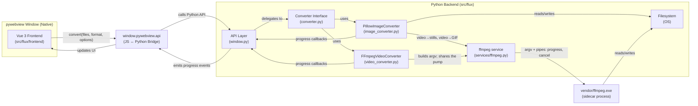

# Flux — Architecture

## System Layers & Data Flow



## API Surface (Exposed to Frontend)

| Method | Arguments | Returns | Errors |
|--------|-----------|---------|--------|
| `convert` | `{ files: { name, size, type, path }[], targetFormat: string, options?: { outputDir: string, quality?: number, dither?: boolean, icoSizes?: number[] } }` | `{ jobId: string }` | `VALIDATION_ERROR`, `UNSUPPORTED_FORMAT` |
| `getProgress` | `{ jobId: string }` | `{ status: 'pending'\|'running'\|'complete'\|'error', progress: 0-100, outputPaths?: string[], outputs?: { input: string, output: string }[], error?: string }` | `NOT_FOUND` |
| `cancel` | `{ jobId: string }` | `{ cancelled: boolean }` | `NOT_FOUND`, `ALREADY_COMPLETE` |
| `getSupportedFormats` | — | `{ input: string[], output: string[], kinds: Record<format, 'image'\|'video'>, targets: Record<input, format[]>, rings: { image: format[], video: format[] } }` — the single source of truth for the UI's conversion matrix *and* the donut's ring grouping (GIF appears in both rings) | — |
| `pickFiles` | `{ multiple?: boolean }` | `{ paths: string[] }` | `CANCELLED` |
| `pickOutputDir` | — | `{ path: string }` | `CANCELLED` |
| `openOutputDir` | `{ path: string }` | `{ opened: boolean }` | `VALIDATION_ERROR`, `OPEN_ERROR` |
| `getFilePreview` | `{ path: string, maxEdge?: number }` | `{ dataUrl: string }` | `VALIDATION_ERROR` |
| `checkForUpdate` | — | `{ available, currentVersion, latestVersion, notes, publishedAt, assetName, assetSize }` | `NETWORK_ERROR`, `NO_RELEASES`, `BAD_RESPONSE` |
| `downloadUpdate` | — | `{ started: boolean }` | `NO_UPDATE` |
| `installUpdate` | — | `{ installing: boolean }` | `NOT_DOWNLOADED`, `UNSUPPORTED_PLATFORM`, `INSTALL_ERROR` |

**Error shape**: `{ code: string, message: string, details?: object }`

### Previews

Previews cross the bridge as base64 data URLs, so the payload is bounded rather
than the file: `getFilePreview` decodes the image and re-encodes it with its
longest edge capped at `maxEdge` (default 512px, i.e. a row thumbnail).
`FileRow` therefore requests a thumbnail when it mounts and a larger render
(2048px) only when the fullscreen modal opens - fetching full resolution for
every row made peak memory scale with batch size while the extra pixels were
never displayed. `maxEdge <= 0` returns the stored bytes, still subject to the
`_MAX_PREVIEW_BYTES` cap. Transparent images stay PNG, everything else
re-encodes as JPEG.

### Dialog results

`create_file_dialog` does not return a consistent type: the WinForms backend
returns a bare string for a single-select OPEN dialog, a tuple of paths for a
multi-select one, and a single-element tuple for FOLDER - the folder dialog is
a re-purposed `OpenFileDialog` whose `FileNames` list is re-wrapped
(`webview/platforms/winforms.py`, `OpenFolderDialog.show`). Selections are
therefore normalized (`_dialog_paths` / `_first_path`) instead of stringified:
`str()` on the tuple stores repr text (`"('C:\\dir',)"`, separators doubled),
which no filesystem call accepts and which made every conversion fail with
`The output directory does not exist`. The frontend applies the same
normalization (`normalizeDirPath`) to what the picker returns and to the value
it reads back from `localStorage`, so a directory persisted in the unusable
shape by an earlier build is migrated instead of re-used.

### Dropped files

A native drop reaches the page as File objects only - the paths of the dropped
files live in WebView2's `CoreWebView2File` additional objects, which pywebview
hands to Python exclusively while a Python-side DOM drop listener is registered
(`FluxAPI.attach_drop_listener`). The page therefore renders dropped rows with a
blob-URL thumbnail and no path, and Python pushes the real paths back as a
`flux-dropped-paths` CustomEvent (`{ detail: { files: [{ name, path, size }] } }`)
once the drop lands, at which point the row is enriched and its preview is
re-fetched as a data URL. Nothing about this flow can be primed from JavaScript:
a JS-side bridge call cannot populate pywebview's drop state.

### In-app updates

The header's bell button (`UpdateBell`) surfaces newer GitHub releases: a
tiny yellow "!" badge appears when `checkForUpdate` (run once at startup,
after the bridge is ready) reports a release newer than `flux.__version__`,
and the popover offers **Download update**, **Dismiss** (session-only) and
**Mark as read** (persists the seen version in `localStorage` under
`flux-seen-release`). The only runtime network calls the app makes are this
check and the user-initiated download. Readiness is re-checked per call, so a
bridge that arrives after the three-second readiness timeout still enables the
update calls, and a check that fails clears the last known release - the card
then shows the quiet "could not check" with a retry rather than a stale update
offer.

Every release (built by `.github/workflows/release.yml` on each `v*` tag)
carries three Windows files: the portable `flux.exe`, the Inno Setup installer
`flux-setup-<ver>.exe` and that installer's `flux-setup-<ver>.exe.sha256`. The
updater downloads the **installer** -
`pick_setup_asset` refuses to fall back to the portable exe - into the OS
temp dir (`flux-update/`), streamed in chunks to a `.part` file that is
renamed only when complete. Everything the payload supplies is validated before
the bytes are read: the installer URL and the checksum URL must be `https` on a
GitHub-controlled host (`is_trusted_download_url`, re-checked after redirects),
the asset name is reduced to a single safe filename component
(`safe_download_name`) so it cannot write outside `flux-update/`, and the
installer is only handed over once its SHA-256 matches the digest published as
the `<installer>.sha256` release asset (`CHECKSUM_MISMATCH` discards the file;
`NO_CHECKSUM` refuses a release that publishes no digest, so an installer that
cannot be verified is never downloaded). Python pushes `flux-update-progress`
CustomEvents (`{ phase: 'downloading' | 'downloaded' | 'error', progress,
received?, total?, message? }`) exactly like `flux-progress`.

Applying an update is an explicit **Restart & update** action:
`installUpdate` launches the downloaded setup with `/SILENT` (per-user
install, `PrivilegesRequired=lowest`, so no UAC prompt) and then destroys
the window. The setup replaces the app's files and relaunches it (see the
`[Run]` entries in `installer/flux.iss`), completing the upgrade to whatever
version the release carried. The action is Windows-only - every release
artifact is a Windows installer - so anywhere else it returns
`UNSUPPORTED_PLATFORM` instead of handing a foreign binary to the OS.

## Threading & Progress Reporting

- **UI thread**: pywebview main loop + Vue frontend (single-threaded JS)
- **Conversion thread**: Each `convert` call spawns a `threading.Thread` running the converter
- **Progress channel**: Converter accepts a `progress_cb(current, total)` callable (float `current` within a file, integral at file boundaries, so a batch bar advances monotonically); backend pushes updates via `window.evaluate_js()` to a Vue-side event bus
- **Job registry**: In-memory dict `jobId → { thread, converter, status, progress, outputPaths, outputs, error }`; cleaned up on completion or explicit cancel. A terminal status deletes the entry, so a poll that arrives afterwards gets `NOT_FOUND` — the frontend treats a response with no recognizable `status` as terminal rather than polling a job that no longer exists
- **Cancellation**: Cooperative — converter checks a `threading.Event` flag between files/operations. Inside one ffmpeg encode the same Event drives `run_ffmpeg`'s three-rung chain: `q` on stdin (exit 0) → `CTRL_BREAK` (exit 255) → process-tree kill after a 10 s grace; exits 0-on-cancel and 255 both read as *cancelled*, never as an error, and the partial output is unlinked

### Matching outputs to rows

A batch that partially fails reports fewer outputs than inputs, so `outputPaths`
alone cannot be zipped with the request rows by position — that shifted every
output after a failure onto the wrong row. `ConversionResult.outputs` carries
`(input, output)` pairs, `getProgress` forwards them as
`{ input, output }[]`, and the frontend matches on the input path. Rows with no
matching output are the ones that failed and are shown as such.

## Converter Interface (Phase 1 images + Phase 2.1 video)

```python
# src/flux/converter.py
from abc import ABC, abstractmethod
from dataclasses import dataclass
from typing import Callable, Optional

@dataclass
class ConversionResult:
    output_paths: list[str]
    errors: list[str]
    outputs: list[tuple[str, str]]   # (input, output) for each success

class BaseConverter(ABC):
    @property
    @abstractmethod
    def supported_input_formats(self) -> list[str]: ...

    @property
    @abstractmethod
    def supported_output_formats(self) -> list[str]: ...

    @property
    def also_video_outputs(self) -> tuple[str, ...]:
        """Outputs that are also video conversions (default: none)."""
        ...

    @abstractmethod
    def convert(
        self,
        input_paths: list[str],
        output_dir: str,
        target_format: str,
        options: dict,
        progress_cb: Callable[[float, float], None],  # (current, total)
        cancel_event: threading.Event,
    ) -> ConversionResult: ...
```

- **Phase 1.1 + 1.3**: `PillowImageConverter` implements `BaseConverter`, covering
  JPG, PNG, WebP, ICO, AVIF, GIF and HEIC/HEIF. `INPUT_FORMATS` /
  `OUTPUT_FORMATS` in `image_converter.py` declare what it can do, and the
  frontend derives its whole input→target matrix from `getSupportedFormats()` —
  there is deliberately no format table in the JS, so a format cannot be
  offered unless an encoder exists for it. AVIF is gated on
  `PIL.features.check("avif")`, so a build without libavif simply does not
  offer it. HEIF is gated on a successful `pillow_heif.register_heif_opener()`,
  so a build without pillow-heif simply does not offer it either. Both `.heic`
  and `.heif` are accepted as inputs (same container); `heic` is the single
  canonical output, following the `jpeg`/`jpg` precedent.
- **Phase 2.1**: `FFmpegVideoConverter` (`video_converter.py`) implements the
  same interface, writing MP4 only and reading the video containers **plus
  GIF**. All ffmpeg process machinery — binary location, the `-encoders`
  capability probe, progress parsing from `out_time`/`Duration`, and the
  three-rung cancel chain — lives once in `services/ffmpeg.py::run_ffmpeg`;
  the video converter builds command lines and the image converter reuses the
  same pump for video→GIF. Gated on `video_available()` end to end: without a
  capable build the converter registers nothing and the matrix stays
  image-only. `MP4_ENCODERS` preference is libx264 first (DECISIONS
  2026-10-24).
- **GIF dual membership**: GIF is written by the image converter — stills
  through Pillow, clips through ffmpeg's palette chain — and the video
  converter merely *reads* it. `also_video_outputs` declares that a format
  can belong to the video ring as well, so the donut's grouping ships as
  registry data (`supported_output_rings` → `getSupportedFormats().rings`)
  instead of a frontend rule.
- **Registry**: `ConverterRegistry` maps format → converter instance;
  `get_converter_for_format()` selects at runtime, `supported_targets_by_input`
  derives the input→target matrix (self-pairings excluded), and
  `supported_output_rings` derives the donut's ring membership.
- **Encoder dispatch**: `_save` rejects any target with no encoder, rather than
  falling through to the last branch — otherwise a format added to
  `OUTPUT_FORMATS` without an encoder would write the previous format's bytes
  under the new extension.

### Runtime dependencies

The app's runtime dependencies are deliberately minimal (Architecture decision 3):

| Dependency | Purpose | Notes |
|------------|---------|-------|
| `pillow` | Image decode/encode | AVIF ships inside Pillow ≥ 11.3 — no extra cost |
| `pillow-heif` | HEIF/HEIC decode/encode | 2.32 MB; registers a Pillow opener. Capability-gated so a build without it still runs. |
| `pywebview` | Desktop shell | Platform backend resolved at runtime |

`pyinstaller` is **build tooling only** (in the `dev` dependency group) — it
produces the frozen exe and is never imported by the running app.

**Sidecar (not a Python dependency)**: `vendor/ffmpeg.exe` — gyan.dev
essentials 9.0.2, GPLv3, ~105 MB, `libx264` included (DECISIONS 2026-10-24).
`locate_ffmpeg()` resolves it beside the frozen executable first (the Inno
Setup deployment path), then `vendor/` in a source checkout, then PATH as a
dev convenience. It is never linked: invocation is argv + pipes, which keeps
the GPL with the binary. `vendor/*.exe` is gitignored; `vendor/README.md`
carries the source URL, version and SHA-256.

## Folder Structure

```
flux/
├── docs/
│   ├── index.html                   # Public project site (deployed to Pages)
│   ├── PRD.md
│   ├── timeline.md
│   ├── ARCHITECTURE.md
│   └── DECISIONS.md
├── .github/
│   └── workflows/
│       ├── test.yml              # CI: pytest, frontend, CSS, installer checks
│       ├── release.yml           # tag-driven release pipeline
│       └── pages.yml             # deploys docs/index.html to GitHub Pages
├── installer/
│   └── flux.iss                  # Inno Setup script (dist/flux.exe → setup)
├── src/
│   └── flux/
│       ├── __init__.py           # __version__ (runtime version source)
│       ├── main.py               # pywebview entry point + --version/--help
│       ├── window.py             # API exposure + JS bridge
│   ├── converter.py          # BaseConverter ABC + registry
│   ├── services/
│   │   ├── ffmpeg.py          # locate/probe/gate + shared run_ffmpeg pump
│   │   ├── image_converter.py  # PillowImageConverter (+ video→stills/GIF)
│   │   ├── video_converter.py  # FFmpegVideoConverter (MP4 out, gif in)
│   │   └── updater.py         # GitHub release check + installer download
│   ├── assets/                 # favicons, logos
│       └── frontend/               # Vue 3 + Tailwind (vendored)
│           ├── index.html
│           ├── src/
│           │   ├── main.js
│           │   ├── App.vue
│           │   ├── components/
│           │   ├── composables/
│           │   └── styles/
│           └── dist/               # built output (committed)
├── scripts/
│   ├── check-frontend.js         # node syntax/template/wiring + default-target behaviour
│   └── ui/                       # headless-browser UI checks (no npm dependencies)
│       ├── lib.js                # browser discovery + CDP driver + instrumented copy
│       ├── check-layout.js       # equal wings, centred button/ring, no sideways scroll
│       ├── check-donut.js        # slice pick, kind toggle, keyboard activation
│       ├── check-picker.js       # row picker's popover: open, pick, Escape, focus
│       ├── check-app.js          # the shipped frontend mounts clean, over file://
│       └── measure.js            # prints the rendered geometry
├── tests/                        # pytest suite (version + updater + format matrix + video)
├── vendor/                       # ffmpeg sidecar (exe gitignored; README pins URL/version/SHA-256)
├── flux.spec                     # PyInstaller spec (dist/flux.exe)
├── pyproject.toml
├── uv.lock
├── .python-version
├── README.md
└── .gitignore
```

## Project Site

`docs/index.html` is a standalone page — no build step, no framework — that
covers the application and shows its release history. It shares the app's design
system rather than defining its own (rationale in DECISIONS 2026-10-02).

### Release & commit data flow

```
GitHub REST API  /repos/agniveshtm/flux/{releases,commits}
        │
        │  fetch on every page load          ← the only data source
        │  localStorage copy, 2-minute TTL   ← absorbs the 60 req/hr limit
        ▼
renders releases, commits, version badge, artifact names
```

No workflow writes a data file. An earlier design regenerated a committed
`docs/cache.json` hourly, which made "recent activity" as stale as the last run
and generated a commit every hour to say so; it was removed once the page read
the API directly (DECISIONS 2026-10-10). REST rather than GraphQL throughout:
GraphQL needs a token, and a token in browser JavaScript is public. GitHub's
unauthenticated cap (60 requests/hour per IP) is worn by the 2-minute
localStorage copy, which also paints instantly on a repeat visit; when it is
exhausted, or the visitor is offline, the section says so with a link to GitHub
rather than showing stale data.

Release bodies are untrusted input. They reach the DOM only through
`textContent`/`createTextNode`, and the API fallback flattens HTML with
`DOMParser`, which produces an inert document — no scripts run, no resources
are fetched. The page contains no `innerHTML`, `outerHTML`, `insertAdjacentHTML`,
`document.write`, `eval` or `new Function`.

### Deployment

`pages.yml` assembles `_site/` — the page and the four assets it needs — and
rewrites the page's `../src/flux/assets/…` references as it copies. Uploading the
repository instead would put the site at `/docs/` and expose
`src/`, `tests/` and `scripts/`; committing duplicate assets would recreate the
second-source problem the format matrix had.

The page is deployed from `docs/` but authored against the repository, so it only
runs on a server, or from a checkout where the `../src/` paths resolve.

## Offline Constraints

- **No CDN**: Vue 3, Tailwind, and all dependencies vendored in `src/flux/frontend/`
- **Tailwind**: Compiled via standalone CLI (`npx tailwindcss -i ... -o ...`) at build time; no Node runtime in packaged app
- **Vue**: Pre-built `dist/` committed; `main.py` loads `file://` path to `dist/index.html`
- **Python deps**: Resolved via `uv` + `uv.lock`; PyInstaller bundles entire `.venv` site-packages
- **Assets**: All icons, logos, fonts embedded in PyInstaller bundle
- **ffmpeg (Phase 2)**: Static binary bundled alongside executable; no system dependency

## Frontend Design Plan

### Color Tokens (CSS Variables)

**Light Theme** (`:root`):
- `--color-bg: #FAFAFA`
- `--color-surface: #FFFFFF`
- `--color-surface-2: #F4F4F5`
- `--color-border: #E4E4E7`
- `--color-text: #0B0B0D`
- `--color-muted: #52525B`
- `--color-accent: #DC143C`
- `--color-accent-hover: #B8102F`
- `--color-accent-active: #970D26`
- `--color-accent-tint: rgba(220, 20, 60, 0.12)`
- `--color-success: #22C55E`

**Dark Theme** (`.dark`):
- `--color-bg: #0B0B0D`
- `--color-surface: #141417`
- `--color-surface-2: #1C1C21`
- `--color-border: #2A2A30`
- `--color-text: #F4F4F5`
- `--color-muted: #A1A1AA`
- `--color-accent: #DC143C`
- `--color-accent-hover: #B8102F`
- `--color-accent-active: #970D26`
- `--color-accent-tint: rgba(220, 20, 60, 0.12)`
- `--color-success: #22C55E`

**Semantic Tailwind Classes** (mapped in tailwind.config.js):
- `bg-surface`, `bg-surface-2`, `bg-bg`
- `text-fg`, `text-muted`
- `border-line`
- `bg-accent`, `text-on-accent`
- `focus-ring-accent`

### Typography

- **Font Family**: Inter (bundled locally) with system-ui fallback
- **Base Size**: 14px (0.875rem)
- **Scale**: 
  - `text-xs` (12px) — metadata, file sizes
  - `text-sm` (14px) — body, labels, buttons
  - `text-base` (16px) — emphasized text
  - `text-lg` (18px) — section headings
  - `text-xl` (20px) — wordmark
- **Weights**: 400 (regular), 500 (medium), 600 (semibold), 700 (bold)

### Layout Concept

- **Window**: ~900×600, resizable, min-width 640px
- **Structure**: Single column, top-to-bottom flow
  1. **Header** (56px): "Flux" wordmark (accent color, semibold) left; ThemeToggle + Settings icon right
  2. **DropZone** (flex-1, min 200px): Dashed border, centered content, crimson tint on drag-over, primary "Select files" button
  3. **FileList** (flex-1, scrollable): Table-like rows, each with filename, size, FormatSelect, status badge, ProgressBar, remove button
  4. **ConversionOptions** (auto height, conditional): Quality slider for lossy targets, GIF dithering toggle — renders nothing when no pending row targets a format that uses them
  5. **Footer** (72px): "Convert all" (primary), "Open output folder" (ghost), output folder selector, "Clear completed"

### State Coverage

| Component | Empty | Loading | Error | Success |
|-----------|-------|---------|-------|---------|
| DropZone | ✓ Drop prompt | — | — | — |
| FileList | ✓ "No files added" | — | — | ✓ "All converted" |
| FileRow | — | ✓ Spinner in status | ✓ Crimson badge + message | ✓ Green badge + path |
| ProgressBar | — | ✓ Animated | ✓ Crimson (error) | ✓ Green (complete) |
| Footer | — | ✓ "Converting..." | ✓ Disabled primary | ✓ "Converted" |

### Transitions & Motion

- 150ms `transition-colors` for hover/focus/active states
- 200ms `transition-opacity` for theme toggle
- `@media (prefers-reduced-motion: reduce)` disables all animations
- No heavy animations; only color/opacity transitions

### Accessibility

- AA contrast in both themes (verified: text 4.5:1, large text 3:1)
- Visible crimson focus rings (`focus-visible: ring-2 ring-accent`)
- Keyboard accessible: all interactive elements reachable and operable
- ARIA labels on icon-only buttons (ThemeToggle, remove, settings)
- Semantic HTML structure